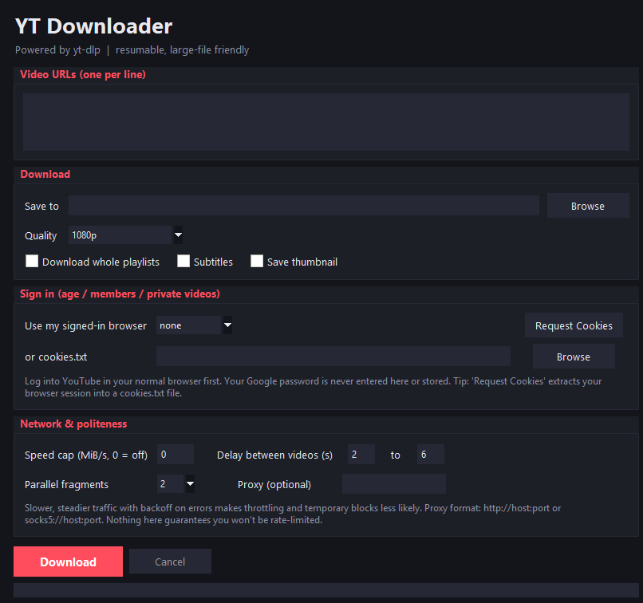

# YT Downloader

A dark-themed desktop app for downloading videos and audio using [yt-dlp](https://github.com/yt-dlp/yt-dlp), built with Python and Tkinter.



## Features

* **Multi-URL Queue:** Paste multiple video or playlist URLs (one per line) and download them one after another.
* **Quality & Audio Selection:** Download up to 4K (`2160p`), standard resolutions (`1080p`, `720p`, etc.), or extract audio-only (`MP3` / `M4A`).
* **Large-File Friendly:** Resumes interrupted `.part` downloads automatically and checks available disk space before starting.
* **Browser Cookie Sign-In:** Access age-restricted, members-only, or private videos using your browser's logged-in session—no Google password is ever entered or stored in the app.
* **Polite Client Controls:** Adjustable speed cap (MiB/s), random delays between videos, and optional proxy support to avoid rate limits.

---

## Installation

### Prerequisites
1. **Python 3.9+** ([Download Python](https://www.python.org/downloads/))
   * *Linux users:* Ensure Tkinter is installed (`sudo apt install python3-tk`).
2. **[FFmpeg](https://ffmpeg.org/download.html)** *(Recommended — needed for merging 1080p/4K video+audio and extracting MP3s)*
   * **Windows:** `winget install Gyan.FFmpeg`
   * **macOS:** `brew install ffmpeg`
   * **Linux (Ubuntu/Debian):** `sudo apt install ffmpeg`

### Option A: Direct Download (No Git Required)
1. **[Click here to download `yt_downloader.py`](https://github.com/PetrSvetr7/Youtube-Downloader-yt-dlp-/releases/latest/download/yt_downloader.py)** *(or right-click the link and choose **Save Link As...**)*.
2. Open a terminal / command prompt and install `yt-dlp`:
   ```bash
   pip install yt-dlp

### Option B: Clone with Git
git clone [https://github.com/](https://github.com/)<your-username>/<your-repo-name>.git
cd <your-repo-name>
pip install -r requirements.txt
python yt_downloader.py
